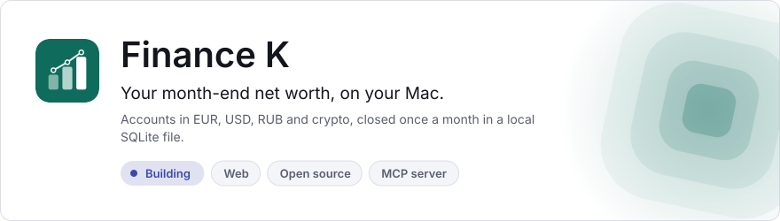
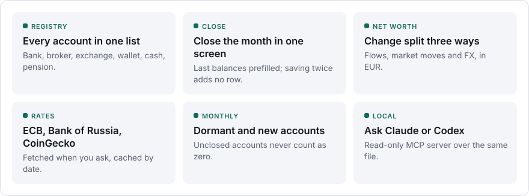
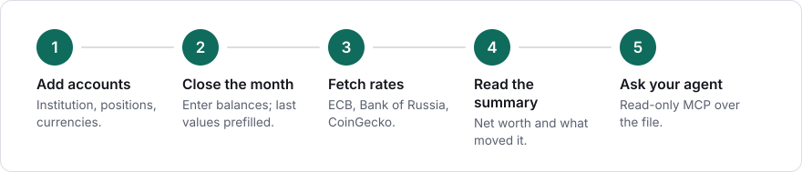

<!-- Pictures: docs/readme/spec.json, drawn by readme-kit. Do not edit the SVGs by hand. -->

<picture><source media="(prefers-color-scheme: dark)" srcset="docs/readme/hero-dark.svg"></picture>

**Close your books once a month and see what moved your net worth: flows, market or FX.**
Built for one person with accounts in several currencies. Sprint 1 is built; bank sync, exchanges and a pushed summary are planned.

[Claude plugin](plugins/finance-k/README.md) · [Privacy](docs/PRIVACY.md) · [Roadmap](docs/ROADMAP.md)

## What it does

<picture><source media="(prefers-color-scheme: dark)" srcset="docs/readme/highlights-dark.svg"></picture>

- **Positions.** Each account holds cash in a currency, or a crypto or security asset. Securities are priced by hand.
- **Editable history.** Past months stay editable. The 12-month line and totals by kind, currency and institution follow.
- **Account kinds.** Bank, broker, exchange, wallet, cash, pension, other.
- **BankJar link.** When idle EUR cash passes a threshold (default 2,000 EUR, a setting), it links to BankJar's savings leaderboard. It may show BankJar's top offer from its public API; a failure is silent.
- **Export and import.** The whole store as versioned JSON (Settings). Import is validated and runs in one transaction.

## How it works

<picture><source media="(prefers-color-scheme: dark)" srcset="docs/readme/steps-dark.svg"></picture>

## Quick start

```
git clone https://github.com/zaitsew/finance-k && cd finance-k
npm install
npm run dev
open http://127.0.0.1:4817        # first run: "Add your first account"
./check.sh                        # typecheck, tests, plugin bundle check, production build
```

Needs Node 24 or newer (it uses the built-in `node:sqlite`). `npm start` serves the production build on the same address after `npm run build`.

## What it doesn't do

- It does not move money or connect to a bank.
- It does not store full IBANs (last 4 digits only) or any bank password.
- The MCP server sends nothing anywhere. The app itself sends nothing except the rate APIs (ECB, Bank of Russia, CoinGecko) and one public, user-data-free GET to BankJar's offers API.
- It binds to 127.0.0.1 only and rejects requests whose Host header is not loopback.

## Ask Claude or Codex about your balances

`finance-k mcp` is a local, read-only MCP server over the same SQLite file: accounts, balances at a month end, month-over-month changes, net worth by currency. No write tools, no network, no hosted version. See the [plugin README](plugins/finance-k/README.md) and [docs/PRIVACY.md](docs/PRIVACY.md).

```
/plugin marketplace add zaitsew/finance-k          # in Claude Code
/plugin install finance-k@finance-k
codex mcp add finance-k -- node "$PWD/plugins/finance-k/server/finance-k.mjs" mcp   # Codex, from a clone
```

## Setup (env)

Both variables are optional; see `.env.example`.

| variable | default | meaning |
|---|---|---|
| `FINANCE_K_DATA_DIR` | `~/Library/Application Support/finance-k` | where `finance-k.sqlite` lives (never inside the repo) |
| `FINANCE_K_IDLE_CASH_EUR` | `2000` | idle-cash threshold in EUR; the Settings value overrides it |

## Usage probe

`./check.sh usage` prints `accounts_open`, `accounts_closed`, `months_closed` and `last_closed_month` from the local database, or `usage_probe=no_db`.

## Status

| Sprint | Scope | State |
|---|---|---|
| 1 | Registry, month-end snapshots, rates, monthly summary, export/import | Built |
| 2 to 4 | EU bank sync (Enable Banking), crypto exchanges and wallets, a monthly summary pushed to you | Planned, see [docs/ROADMAP.md](docs/ROADMAP.md) |

<details>
<summary>Layout</summary>

- `src/core/` pure domain code: decimals, money, delta split, summary, dormant detection, schemas
- `src/server/` SQLite, numbered migrations, repository, rates client, server actions, export/import
- `app/`, `components/` the Next.js UI
- `mcp/` the MCP server; `plugins/finance-k/` the Claude plugin bundle (`npm run build:mcp` rebuilds `server/finance-k.mjs`); `.claude-plugin/marketplace.json`
- `tests/` vitest, with trimmed real rate payloads in `tests/fixtures/`

</details>

## Docs

| Document | What is in it |
|---|---|
| [docs/GETTING-STARTED.md](docs/GETTING-STARTED.md) | First run |
| [docs/PRIVACY.md](docs/PRIVACY.md) | What stays local, what is sent |
| [docs/ROADMAP.md](docs/ROADMAP.md) | Sprints 2 to 4 |
| [docs/DECISIONS.md](docs/DECISIONS.md) | Decisions and their history |
| [docs/DIRECTORY.md](docs/DIRECTORY.md) | Claude plugin directory and ChatGPT listing status |
| [plugins/finance-k/README.md](plugins/finance-k/README.md) | Claude plugin and Codex install |

## Licence

See `LICENSE`.

<sub>Built by <a href="https://github.com/zaitsew">zaitsew</a> with a fleet of AI agents.</sub>

<!-- teyla:reviewed 2026-11-13 -->
